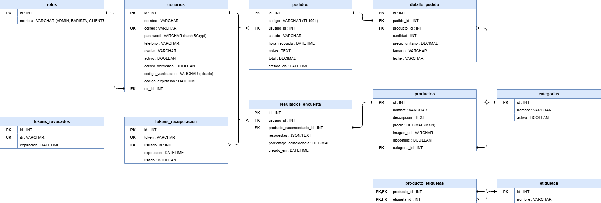
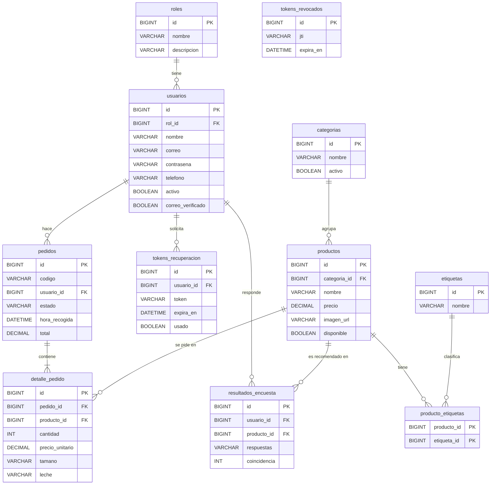
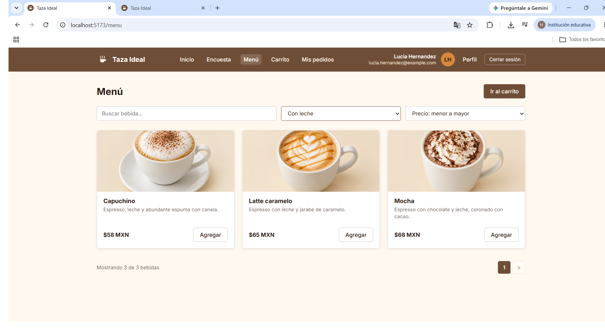
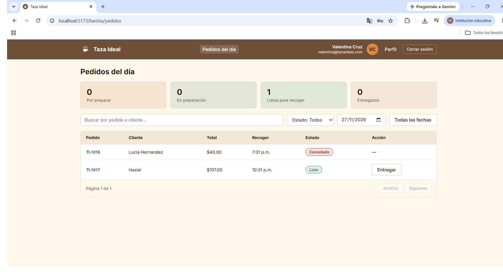
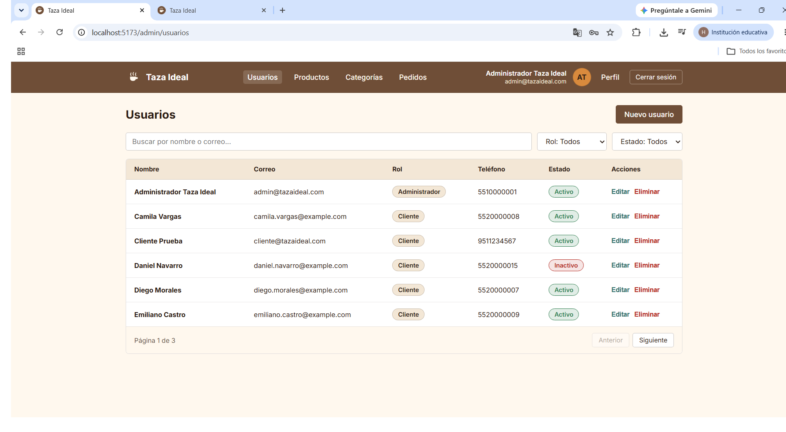
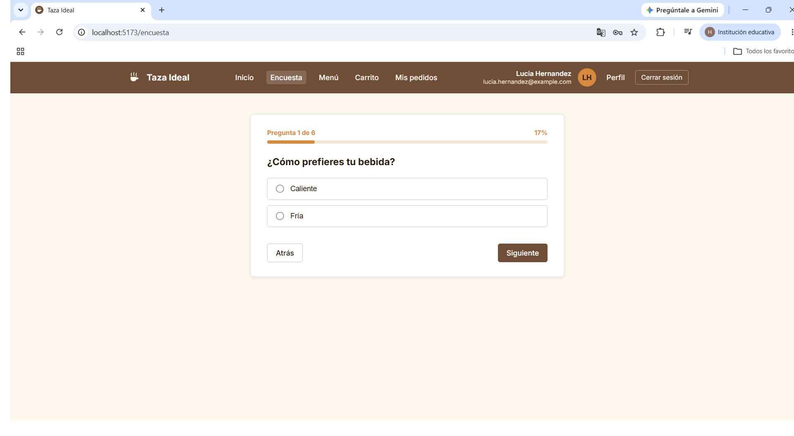
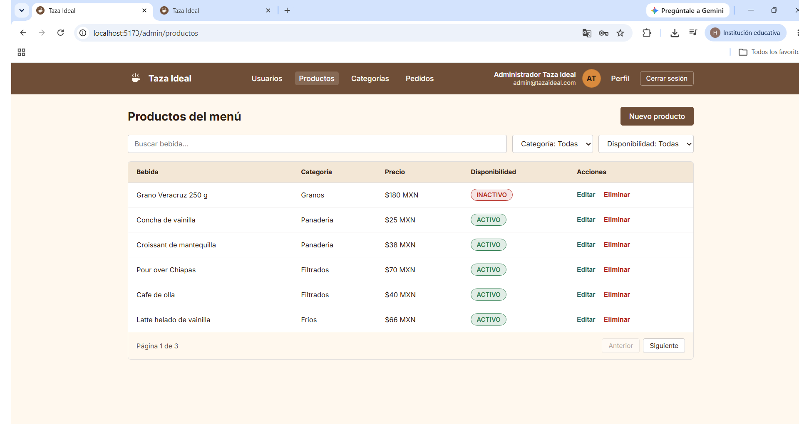
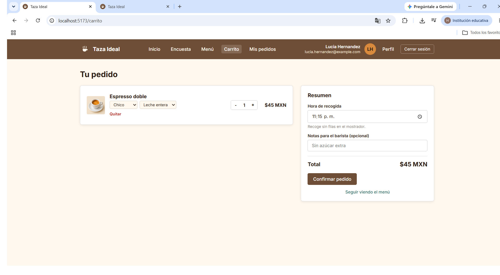
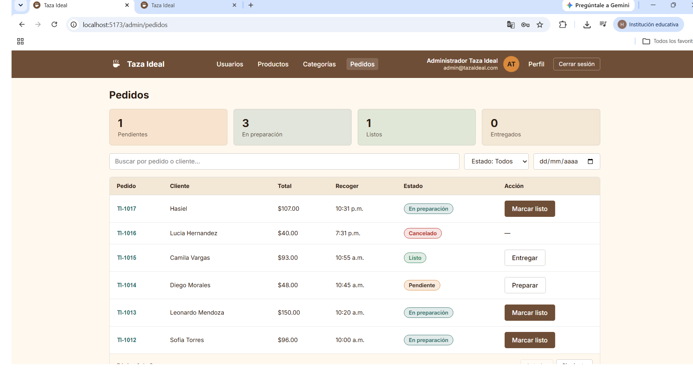
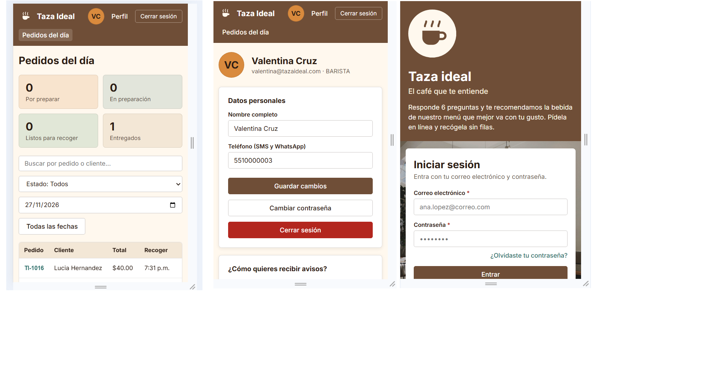

# ☕ Taza Ideal

Plataforma web full stack para cafeterías que ayuda a los clientes a descubrir qué bebida pedir mediante una encuesta personalizada de 6 preguntas, realizar pedidos en línea y recibir avisos automáticos por correo electrónico, SMS y WhatsApp cuando su orden está lista.

**Equipo 10**

| | |
|---|---|
| 🌐 **Sitio en producción (HTTPS)** | https://tazaideal.online |
| 🔌 **URL base de la API** | https://tazaideal.online/api |
| 🎨 **Prototipo en Figma** | [Taza Ideal – Diseño web](https://www.figma.com/design/WqwwCqGV5Cg9MSqDaG5IW0/Taza-ideal---Dise%C3%B1o-web) |
| 📋 **Tablero de GitHub Projects** | [Tablero Taza Ideal](https://github.com/users/CristianMartinezz1/projects/1) |
| 💻 **Repositorio** | [CristianMartinezz1/Taza-Ideal](https://github.com/CristianMartinezz1/Taza-Ideal) |

## 👥 Integrantes del equipo
* **Cristian Martínez Pacheco**: base de datos, backend (Spring Boot), seguridad JWT, notificaciones y despliegue en el VPS.
* **Hasiel Isai Mendoza Lucero**: frontend (React), diseño responsivo, diagrama ER y pruebas de API con Bruno.

## 🎯 Problema que resuelve
Muchos clientes no saben qué café elegir ante un menú amplio y hacen fila para pedir. **Taza Ideal** los guía con una encuesta rápida de 6 preguntas sobre sus gustos (sabor, temperatura, intensidad), les recomienda la bebida del menú con mayor coincidencia y les permite pedirla en línea para recogerla sin hacer fila. El barista recibe la cola de pedidos del día y, al marcar uno como *Listo*, el sistema avisa al cliente automáticamente.

## 🔐 Roles del sistema
| Rol | Qué puede hacer |
|---|---|
| **Administrador** | Acceso total: CRUD de usuarios, productos (con fotografía) y categorías; supervisión y cambio de estado de todos los pedidos. |
| **Barista** | Ver los pedidos del día con búsqueda y filtros, y avanzar su estado `Pendiente → En preparación → Listo → Entregado`. Al marcar *Listo* se envía el aviso al cliente. |
| **Cliente** | Registro con verificación de correo, encuesta de 6 preguntas, menú con filtros, carrito, crear y cancelar sus pedidos, historial y perfil. Solo ve sus propios datos. |

## 🔑 Credenciales de prueba
Todas vienen cargadas por la migración `V2__datos_prueba.sql`.

| Rol | Correo | Contraseña |
|---|---|---|
| **Administrador (evaluación)** | `admin@tazaideal.com` | `Admin#2026` |
| Barista | `andres@tazaideal.com` | `Barista#2026` |
| Barista | `valentina@tazaideal.com` | `Barista#2026` |
| Cliente | `lucia.hernandez@example.com` | `Cliente#2026` |
| Cliente | `mateo.ramirez@example.com` | `Cliente#2026` |
| Cliente | `sofia.torres@example.com` | `Cliente#2026` |

Hay 12 clientes de prueba en total, todos con la contraseña `Cliente#2026`. Casos especiales: `renata.silva@example.com` tiene el correo sin verificar y `daniel.navarro@example.com` está desactivado (no puede iniciar sesión).

> Los correos `@example.com` son ficticios. Para probar los avisos por correo, SMS o WhatsApp, regístrate con un correo y un teléfono reales.

## 🛠️ Tecnologías utilizadas
* **Frontend:** React 19, Vite, React Router, Axios, CSS con tokens del sistema de diseño (fuente Inter).
* **Backend:** Java 21, Spring Boot 4, Spring Security + JWT (jjwt), Spring Data JPA / Hibernate, Bean Validation, Flyway, Maven.
* **Base de datos:** MySQL 8+ (no MariaDB).
* **Comunicación:** Postfix + JavaMailSender (correo), Twilio (SMS y WhatsApp).
* **Pruebas de API:** Bruno (colección en la carpeta [`bruno/`](bruno)).
* **Infraestructura:** VPS Ubuntu, Nginx, systemd, HTTPS con Let's Encrypt (Certbot).

## 🗄️ Base de datos

### Diagrama Entidad-Relación




* **11 tablas** creadas y versionadas con **Flyway** (`backend/src/main/resources/db/migration`):
  * `V1__esquema.sql` crea las tablas.
  * `V2__datos_prueba.sql` carga los datos de prueba: 3 roles, 15 usuarios, 6 categorías, 15 productos, 10 etiquetas y 15 pedidos con su detalle.
* **Relación N:M:** `productos` ↔ `etiquetas` mediante la tabla intermedia `producto_etiquetas` (`@ManyToMany` en JPA). Un producto tiene varias etiquetas (por ejemplo *dulce*, *frío*, *sin cafeína*) y una etiqueta se aplica a varios productos; la encuesta usa esas etiquetas para calcular la coincidencia.
* `spring.jpa.hibernate.ddl-auto=validate`: Hibernate **no** crea tablas, solo verifica que coincidan con las migraciones.
* Las relaciones son `LAZY` y se cargan con `@EntityGraph` y `@BatchSize` para evitar el problema N+1.
* Las contraseñas se guardan hasheadas con **BCrypt**.
* **Scripts SQL:** [`database/crear_base.sql`](database/crear_base.sql) crea la base y el usuario de la aplicación. El respaldo completo de la base está en la carpeta [`database/`](database).

## 🔌 API REST
URL base: **`https://tazaideal.online/api`**. Las rutas protegidas reciben el token en el header `Authorization: Bearer <token>`.

| Módulo | Endpoints | Acceso |
|---|---|---|
| Autenticación | `POST /auth/registro`, `POST /auth/login`, `POST /auth/logout`, `GET /auth/yo`, `POST /auth/verificar`, `POST /auth/reenviar-codigo`, `POST /auth/recuperar`, `POST /auth/restablecer` | Público (salvo `logout` y `yo`) |
| Catálogo | `GET /productos`, `GET /productos/{id}`, `GET /categorias`, `GET /etiquetas` | Público |
| Encuesta | `POST /encuesta`, `GET /encuesta/ultima` | Cliente |
| Pedidos del cliente | `POST /pedidos`, `GET /pedidos/mios`, `GET /pedidos/{id}`, `PATCH /pedidos/{id}/cancelar` | Cliente |
| Barista | `GET /barista/pedidos`, `GET /barista/pedidos/{id}`, `PATCH /barista/pedidos/{id}/estado` | Barista, Admin |
| Perfil | `GET /perfil`, `PUT /perfil`, `PUT /perfil/contrasena` | Cualquier usuario autenticado |
| Admin: usuarios | `GET/POST /admin/usuarios`, `GET/PUT/DELETE /admin/usuarios/{id}` | Admin |
| Admin: productos | `GET/POST /admin/productos`, `GET/PUT/DELETE /admin/productos/{id}`, `POST /admin/productos/{id}/foto` | Admin |
| Admin: categorías | `GET/POST /admin/categorias`, `GET/PUT/DELETE /admin/categorias/{id}` | Admin |
| Admin: pedidos | `GET /admin/pedidos`, `GET /admin/pedidos/{id}`, `PATCH /admin/pedidos/{id}/estado` | Admin |

**Listados paginados en el servidor:** reciben `page`, `size` y `sort`, más filtros como parámetros (`q`, `estado`, `fecha`, `categoriaId`, `rol`, `activo`, `disponible`), y regresan solo los registros de esa página.

**Seguridad y validación:**
* **Autenticación y roles:** Spring Security sin sesión (`STATELESS`) con filtro JWT; autorización por rol en `SecurityFilterChain` y `@PreAuthorize`.
* **Logout:** invalida el token guardando su `jti` en `tokens_revocados`.
* **Validación:** todos los DTOs de entrada usan Bean Validation (`@Valid`, `@NotBlank`, `@Email`, `@Size`, `@Pattern`). La contraseña exige al menos 8 caracteres, una mayúscula, un número y un carácter especial; la misma regla se valida bajo el input en React.
* **Errores:** salen en JSON desde `@RestControllerAdvice` con el código correcto: 400 (datos inválidos), 401 (sin token o token inválido), 403 (rol sin permiso), 404 (no existe), 422 (regla de negocio, por ejemplo cancelar un pedido ya preparado) y 500 (error inesperado).
* **Respuestas:** siempre son DTOs (`record`); nunca se exponen las entidades JPA.

Ejemplo de error:
```json
{ "fecha": "2026-11-28T04:21:56Z", "estado": 401, "error": "Unauthorized", "mensaje": "Inicia sesión para continuar", "ruta": "/api/pedidos/mios" }
```

## 📣 Comunicación con el usuario
| Canal | Cuándo se envía | Cómo |
|---|---|---|
| **Correo** | Código de verificación al registrarse, enlace de recuperación de contraseña, pedido recibido y **pedido listo**. | `JavaMailSender` → **Postfix** instalado en el VPS, con registros **SPF** y **DKIM** en el DNS del dominio. |
| **SMS** | Cuando el barista marca el pedido como *Listo*. | API REST de **Twilio**. |
| **WhatsApp** | Cuando el barista marca el pedido como *Listo*. | API de WhatsApp de **Twilio**. |

Los envíos se hacen en segundo plano (`@Async`) y solo después de confirmar la transacción, así que si una operación falla no se manda ningún aviso.

## 🎨 Diseño
* **Prototipo navegable en Figma**, con las pantallas de los 3 roles: [Taza Ideal – Diseño web](https://www.figma.com/design/WqwwCqGV5Cg9MSqDaG5IW0/Taza-ideal---Dise%C3%B1o-web).
* **Logo original** del equipo: [`frontend/public/tazalogo.svg`](frontend/public/tazalogo.svg).
* **Paleta de colores** (definida en [`frontend/src/styles/tokens.css`](frontend/src/styles/tokens.css)):

| Color | Hex | Uso y justificación |
|---|---|---|
| Café | `#6F4E37` | Color principal (navbar, botones). Tono cálido y terroso que remite directamente al café y transmite confianza. |
| Caramelo | `#D98A3D` | Acento para llamadas a la acción. Es análogo al café (misma familia cálida), así que armoniza y a la vez destaca. |
| Verde azulado | `#2F6F6A` | Enlaces y detalles. Es el complementario de los tonos naranja-café: da contraste sin romper la calidez. |
| Crema | `#FFF8EE` | Fondo general. Neutro cálido que evoca la espuma de leche y descansa la vista. |
| Chocolate | `#2B1D14` | Texto. Casi negro pero cálido, con alto contraste sobre crema para buena legibilidad. |
| Rojo / Verde | `#B3261E` / `#2E7D4F` | Estados de error y de éxito. |

## 📸 Capturas
| Cliente | Barista | Administrador |
|---|---|---|
|  |  |  |
|  |  |  |
|  | |  |

**Vista en celular (375 px):**



Más capturas en [`docs/capturas`](docs/capturas).

## ⚙️ Instalación local

### Requisitos
* Java 21 o superior
* Node.js 20 o superior
* MySQL 8 o superior
* Git

### 1. Clonar
```bash
git clone https://github.com/CristianMartinezz1/Taza-Ideal.git
cd Taza-Ideal
```

### 2. Base de datos
Edita la clave en `database/crear_base.sql` (`CAMBIA_ESTA_CLAVE`) y ejecútalo como root:
```bash
mysql -u root -p < database/crear_base.sql
```
Las tablas y los datos de prueba **no** se crean a mano: los crea Flyway al arrancar el backend.

### 3. Backend
```bash
cd backend
cp src/main/resources/application.properties.example src/main/resources/application.properties
# Llena: spring.datasource.password, app.jwt.secreto y, si quieres envíos reales, correo y Twilio
./mvnw spring-boot:run          # en Windows: .\mvnw.cmd spring-boot:run
```
La API queda en `http://localhost:8080/api`.

`application.properties` está en `.gitignore`: **nunca se sube al repositorio**. Solo se versiona `application.properties.example`, sin valores reales.

### 4. Frontend
```bash
cd frontend
npm install
npm run dev
```
Abre `http://localhost:5173` e inicia sesión con alguna de las credenciales de prueba.

### 5. Pruebas con Bruno
Abre la carpeta [`bruno/`](bruno) en Bruno y elige el entorno `Local` o `Produccion`. La colección incluye:
* `01-Auth`: login (guarda el token JWT automáticamente), registro y logout.
* `02-Modulos`: peticiones protegidas con el token (productos, categorías, usuarios, pedidos, encuesta).
* `03-Casos-Error`: errores a propósito (400 contraseña débil, 401 sin token, 403 rol equivocado, 404 pedido inexistente y 422 cancelar un pedido ya preparado).

## 🚀 Despliegue en el VPS
Todo corre en el mismo servidor (Ubuntu):

* **Backend:** JAR de Spring Boot ejecutado como servicio **systemd** (`deploy/taza-ideal.service`) en `127.0.0.1:8085`.
* **Frontend:** build estático de Vite en `/var/www/taza-ideal`.
* **Nginx** (`deploy/nginx-taza-ideal.conf`): sirve el frontend y redirige `/api` al backend.
* **HTTPS:** certificado gratuito de **Let's Encrypt** obtenido con **Certbot**.
* **Base de datos:** MySQL en el mismo VPS (`deploy/crear_base_vps.sql`).
* **Correo:** Postfix en el VPS, con SPF y DKIM.
* **Configuración privada:** solo en el servidor, en `/opt/taza-ideal/application.properties`.

Para publicar se usa `deploy/publicar.ps1`, que compila exactamente la rama `main` y la sube al servidor; en el VPS no se edita código a mano. Los pasos completos están en [`deploy/DESPLIEGUE.md`](deploy/DESPLIEGUE.md).

## 🗂️ Organización del trabajo
* Tablero de **GitHub Projects** con columnas *Backlog, To Do, In Progress, In Review, Done*: [ver tablero](https://github.com/users/CristianMartinezz1/projects/1).
* Cada tarea es un issue. Se trabaja en una rama `feature/…` o `fix/…` y se integra a `main` con un Pull Request revisado por el otro integrante (`Closes #N`).
